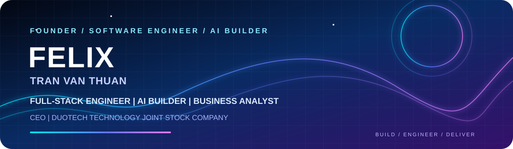
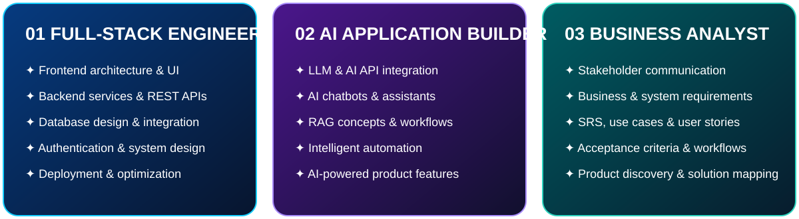

<!--
  GitHub Profile README — Tran Van Thuan
  Custom SVG assets are stored in /assets.
-->

 

  

 

---

## 👋 About Me

I'm **Trần Văn Thuần**, a Software Engineering student at **FPT University** and **Founder & CEO of DUOTECH TECHNOLOGY JOINT STOCK COMPANY**.

I work across the complete digital product lifecycle — from understanding business needs and defining requirements to engineering full-stack applications, integrating AI capabilities, and delivering solutions for real users.

My strength is connecting **engineering execution, AI innovation, and business analysis**. I don't just focus on how to build a product; I also care about why it should exist, who it serves, and what value it delivers.

> **From business requirements to production-ready products — I connect the entire journey.**

## 🚀 Core Expertise

## 🧰 Technology & Tools

**Programming Languages**

**Frontend Engineering**

**Backend, Database & Cloud**

**Development Workflow & Design**

## ✨ Selected Projects

| Project | Product / Business Value | Contribution Focus |
|:--|:--|:--|
| **EZ Luyện Thi** | Online learning and exam-practice platform | Product development · Full-stack delivery |
| **TAM THANH AYO** | Digital map supporting local digital transformation | Business analysis · Requirements · Product coordination |
| **AI Construction Management** | Digital workflows and AI applications for construction operations | Product analysis · AI solution direction |
| **Hotel & Business Systems** | Web platforms and operational systems for business clients | Full-stack engineering · Project delivery |
| **3D Ticketing Experience** | Interactive 3D ticketing experience for live entertainment | Product and technical coordination |

## 🏆 Leadership & Highlights

- **Founder & CEO — DUOTECH TECHNOLOGY JOINT STOCK COMPANY:** Leading product direction, technology initiatives, client collaboration, and project delivery.
- **FPT University:** Software Engineering.
- **Academic Achievement:** Top 10% scholarship.
- **FPT WebDesign:** Competition winner.
- **Community Building:** Built and supported a learning community of 1,000+ members.
- **Cross-functional mindset:** Comfortable working with clients, developers, designers, testers, and business stakeholders.

## 🌐 Languages

## 📊 GitHub Analytics

 

## 🤝 Let's Connect

I'm open to collaboration, product-building opportunities, and conversations around **software engineering, AI applications, digital products, and business analysis**.

  

**BUILD WITH PURPOSE · ENGINEER WITH CLARITY · CREATE REAL IMPACT**

