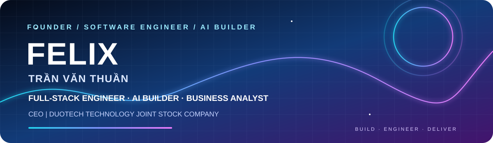

<!-- Profile README | Tran Van Thuan (Felix) -->

  
  
  
  

---

## About

I'm **Trần Văn Thuần (Felix)** — a Software Engineering student at **FPT University**, Founder & CEO of **DUOTECH TECHNOLOGY**.

I work at the intersection of **software engineering, AI, and product development**. I enjoy taking an idea from its early requirements to a working product — connecting business needs with practical technology and thoughtful execution.

My approach is simple: understand the problem, build with purpose, and deliver something people can actually use.

## What I Do

<table>
  <tr>
    <td width="33%" valign="top">
      <h3>01 · Software Engineering</h3>
      
Building reliable, user-focused web applications from frontend to backend.

      <ul>
        <li>Full-stack web development</li>
        <li>REST APIs & database design</li>
        <li>Authentication & deployment</li>
      </ul>
    </td>
    <td width="33%" valign="top">
      <h3>02 · AI Product Development</h3>
      
Turning AI capabilities into practical features and useful workflows.

      <ul>
        <li>LLM and AI API integration</li>
        <li>Chatbots & AI assistants</li>
        <li>Workflow automation</li>
      </ul>
    </td>
    <td width="33%" valign="top">
      <h3>03 · Product & Business Analysis</h3>
      
Bridging stakeholder needs, product decisions, and engineering teams.

      <ul>
        <li>Requirement analysis & SRS</li>
        <li>User stories & use cases</li>
        <li>Product coordination & delivery</li>
      </ul>
    </td>
  </tr>
</table>

## Technology

**Languages**

**Frontend**

**Backend · Database · Cloud**

**Tools & Workflow**

## Selected Projects

A selection of products and systems I've contributed to across education, local digital transformation, construction, hospitality and entertainment.

| Project | Overview | Contribution |
|:--|:--|:--|
| **EZ Luyện Thi** | Online learning and exam-practice platform | Product development · Full-stack delivery |
| **TAM THANH AYO** | Digital map supporting local digital transformation | Business analysis · Requirements · Product coordination |
| **AI Construction Management** | Digital workflows and AI applications for construction operations | Product analysis · AI solution direction |
| **Hotel & Business Systems** | Web platforms and operational systems for business clients | Full-stack engineering · Project delivery |
| **3D Ticketing Experience** | Interactive 3D ticketing experience for live entertainment | Product and technical coordination |

## Leadership & Highlights

- **Founder & CEO — DUOTECH TECHNOLOGY JOINT STOCK COMPANY:** Leading product direction, technology initiatives, client collaboration and project delivery.
- **FPT University:** Software Engineering.
- **Academic Achievement:** Top 10% scholarship.
- **FPT WebDesign:** Competition winner.
- **Community Building:** Built and supported a learning community of 1,000+ members.
- **Cross-functional collaboration:** Experience working with clients, developers, designers, testers and business stakeholders.

## GitHub Analytics

 

## Let's Connect

I'm open to meaningful collaboration and conversations around **software engineering, AI applications, digital products and business analysis**.

  

**BUILD WITH PURPOSE · ENGINEER WITH CLARITY · CREATE REAL IMPACT**

