


 

  

  

  

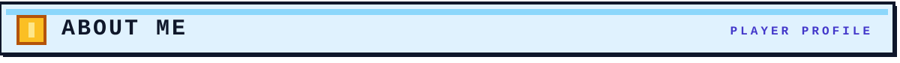

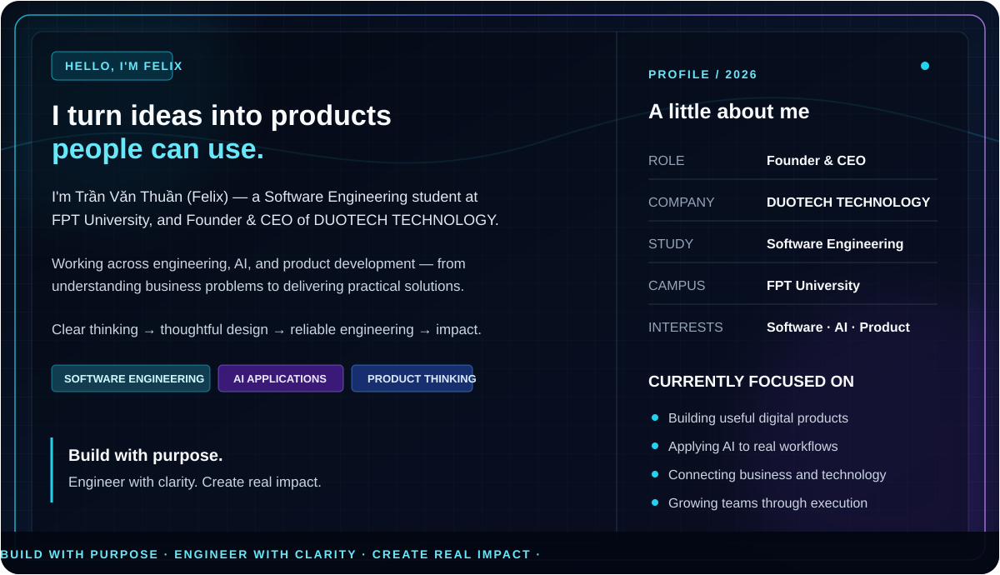

 


 

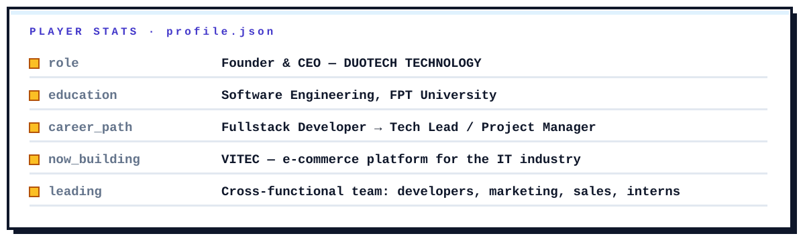

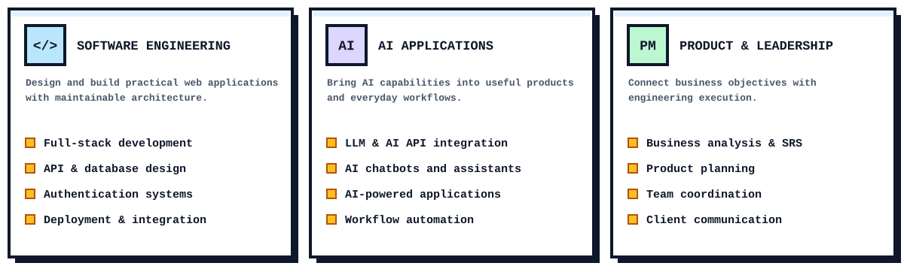

 

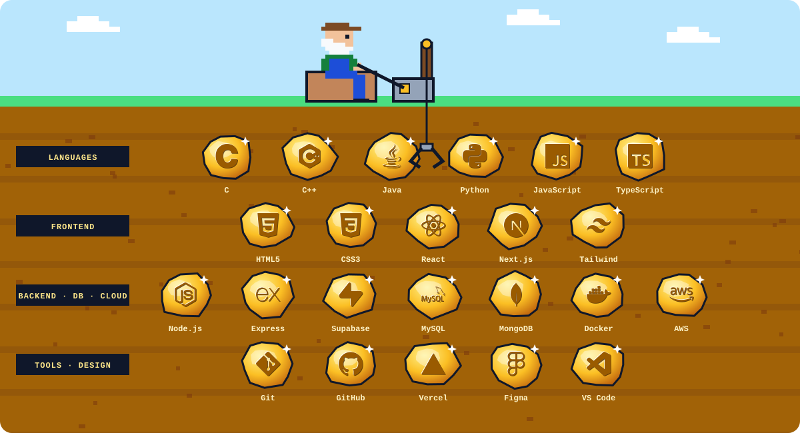

 


A selection of products and systems across education, digital transformation, construction, hospitality, and entertainment.


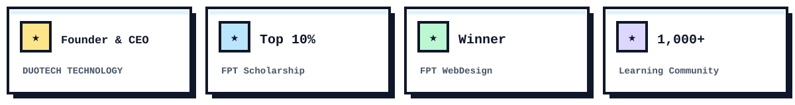

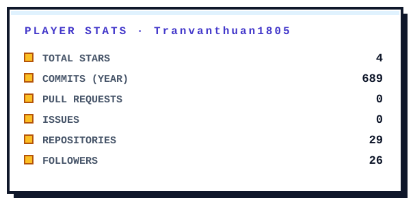
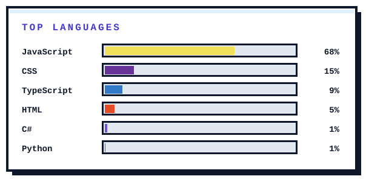

 

 

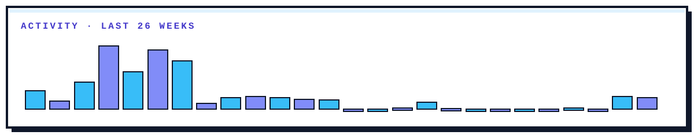

 

<picture>
  <source media="(prefers-color-scheme: dark)" srcset="https://raw.githubusercontent.com/Tranvanthuan1805/Tranvanthuan1805/output/github-contribution-grid-snake-dark.svg" />
  
</picture>

### Have an idea, a product challenge, or an opportunity to collaborate?

Let's build something meaningful together.

  

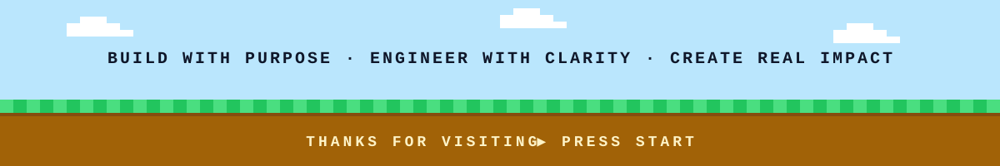

